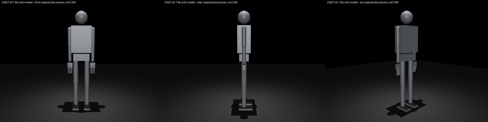
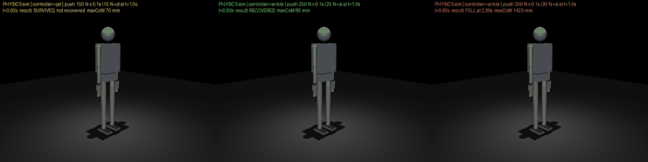
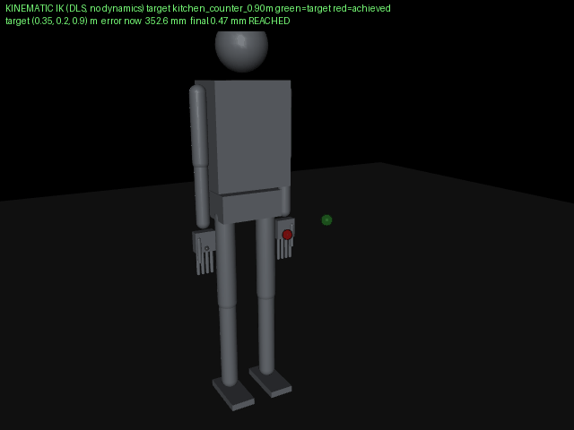
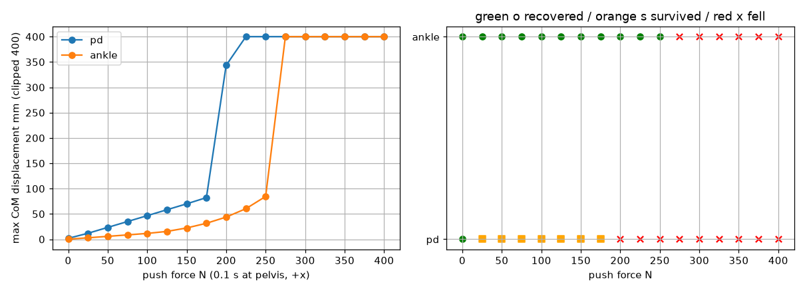
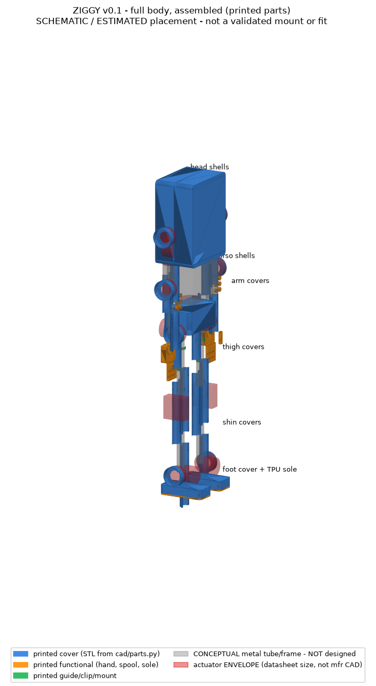
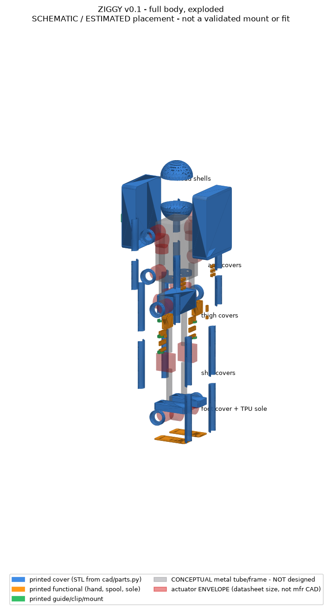
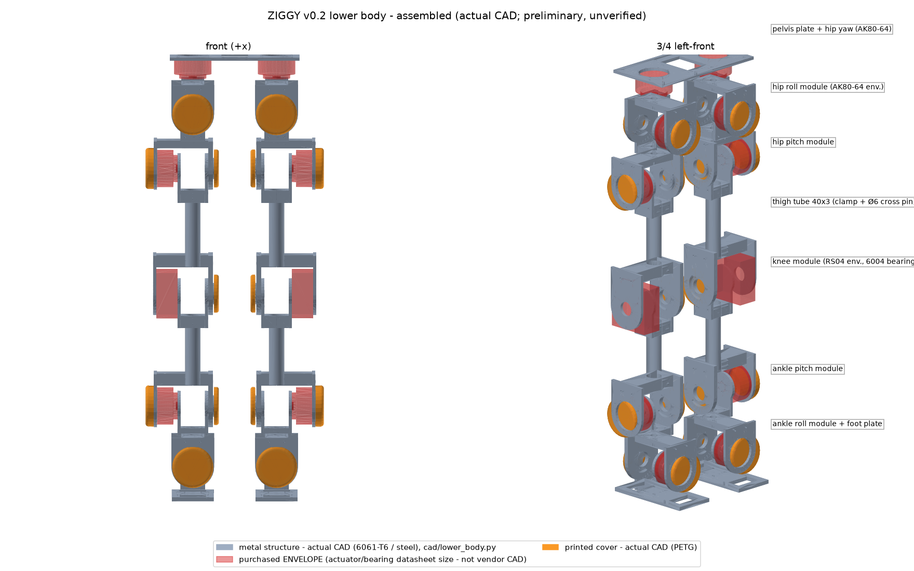
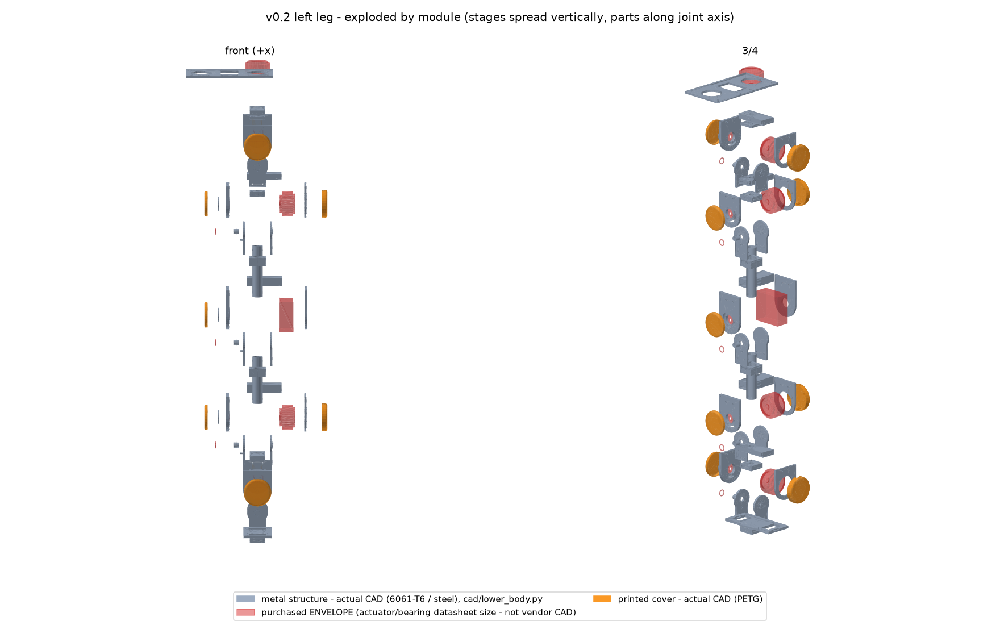
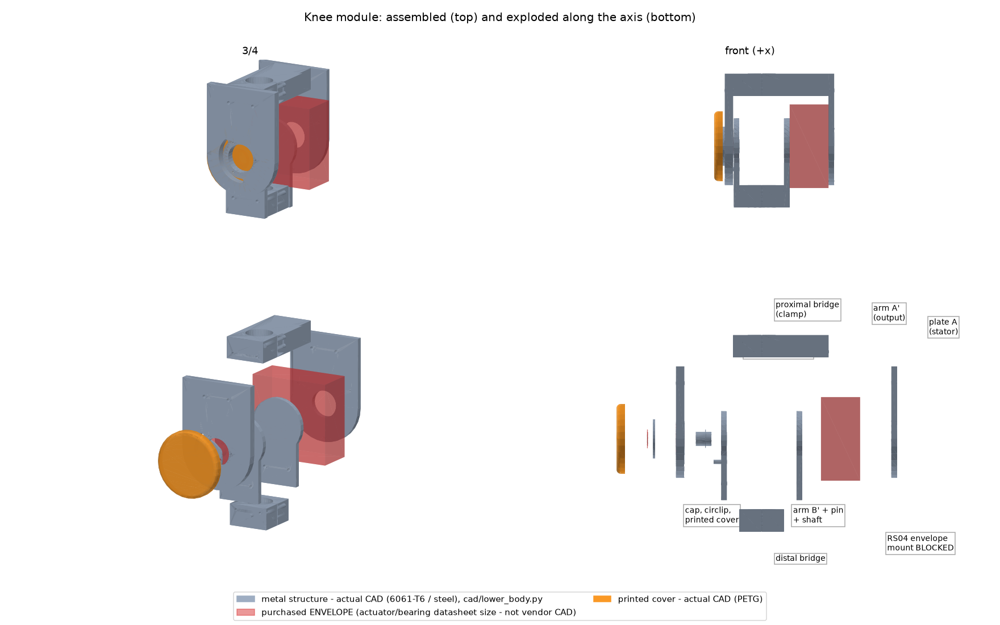
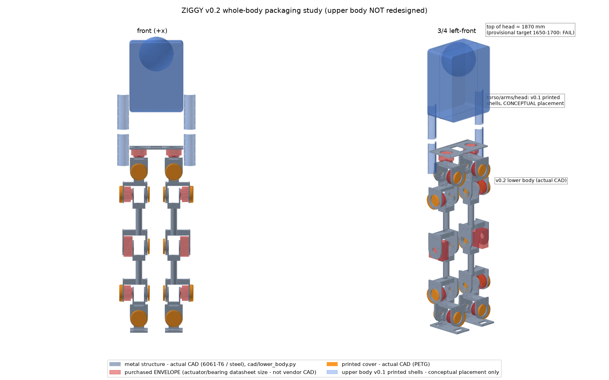

<!-- SPDX-License-Identifier: CC-BY-4.0 -->
# ZIGGY: open-source full-size household humanoid (v0.2 engineering prototype)

ZIGGY is a humanoid targeting ~1.65 m and ~46 kg (provisional; the v0.2 lower-body CAD currently packages to 1.87 m and is over mass) for household manipulation research, with
parametric CAD, separate STEP/STL files for every printed part (each fits an **ELEGOO Neptune 4 Max**),
a MuJoCo model, IK and standing-stability tests, a BOM, a wiring architecture and a recursive QA loop.

> **Status: design + simulation baseline. No physical robot has been built or tested.**
> Walking, dynamic balance, structural strength, grasping and household safety are **unverified**
> (see [`docs/claims.json`](docs/claims.json), enforced by `tests/test_release_gates.py`).
> Read [SAFETY.md](SAFETY.md) before you build anything. A full-size robot can seriously injure people.

## Simulation and CAD previews
| MuJoCo model (physics proxies, not CAD) | Push response: PD 150 N survives but doesn't settle · ankle strategy 250 N recovers · 300 N falls |
|---|---|
|  |  |
| **Kinematic IK to household targets** (green = target, red = achieved; table and floor unreachable) | **Push sweep** (0.1 s forward push) |
|  |  |
| **CAD assembled** (schematic placement; grey and red = conceptual metal and actuator envelopes) | **CAD exploded** |
|  |  |

Details, assumptions and limits: [docs/SIMULATION.md](docs/SIMULATION.md) and [docs/ASSEMBLY.md](docs/ASSEMBLY.md). Metrics: [media/metrics.json](media/metrics.json).
Simulated actuators are ideal and clamped at peak torque, so these results are optimistic. **Walking is not implemented.**

## v0.2 lower body (preliminary; manufacturing release blocked: 2/11 gates pass)
| Assembled (front + 3/4) | Exploded |
|---|---|
|  |  |
| **Knee module close-up** | **Full-body packaging (1870 mm, over target)** |
|  |  |

Read [LOWER_BODY](docs/LOWER_BODY.md), [ENGINEERING_GATES](docs/ENGINEERING_GATES.md), [HAND_CALCS](docs/HAND_CALCS.md), [VERIFICATION](docs/VERIFICATION.md),
[BENCHMARKING](docs/BENCHMARKING.md), [DESIGN_REVIEW](docs/DESIGN_REVIEW.md) and [ENGINEERING_STATUS](docs/ENGINEERING_STATUS.md).
Regenerate everything with `python tools/qa.py`, or run the steps on their own: `python tools/lower_body_qa.py && python tools/hand_calcs.py && python tools/engineering_gates.py && python tools/lower_body_views.py`.
Known blockers: no RobStride 04 mount drawing (adapters undrilled) · collapses when de-energized · over mass and stature · CAD and sim not yet synced.

## What's here

| Area | Contents | Status |
|---|---|---|
| Parameters | `ziggy/params.py`: dimensions, masses, joints, actuator ratings (cited) | single source of truth |
| Simulation | `sim/ziggy.xml`, generated by `ziggy/mjcf.py`: 29 body joints plus 2 tendon-coupled 5-finger hands (41 actuators) | runs in MuJoCo 4.0 |
| IK | `ziggy/analysis.py`: damped-least-squares IK on MuJoCo Jacobians, plus a benchmark | simulated |
| Balance | contact-based support margin, PD vs ankle-strategy push sweeps, fall/recovery detection | simulated standing only, no walking |
| Torque | static Jacobian-transpose torques compared with rated and peak ratings | estimate |
| CAD | `cad/parts.py` (CadQuery): 20 printed part types; `hardware/step`, `hardware/stl`, `hardware/manifest.json` | preliminary |
| Electronics | [docs/WIRING.md](docs/WIRING.md), [docs/BOM.md](docs/BOM.md) | architecture |
| Assembly | [docs/ASSEMBLY.md](docs/ASSEMBLY.md), [docs/MECHANICAL.md](docs/MECHANICAL.md), [docs/PRINTING.md](docs/PRINTING.md) | concept |
| QA/QC | `tools/qa.py`, `tests/`, CI workflow in `ci/` (inactive: the push token lacks `workflow` scope), [docs/REQUIREMENTS.md](docs/REQUIREMENTS.md), [docs/validation/](docs/validation/) | runs |
| Gaps | [docs/NOT_YET_DESIGNED.md](docs/NOT_YET_DESIGNED.md) | honest inventory |

## Why these tools
* **CadQuery**: Python parametric B-rep CAD (OpenCascade). It exports real STEP and STL, can be diffed in git and runs in CI. The STEP files open in FreeCAD, Fusion and Onshape for editing.
* **MuJoCo**: an open-source physics engine with a fast Jacobian API, stable contact handling and Python bindings. It is the usual simulator for legged robots and works well for IK and stance tests.

## Quick start
```bash
python -m venv .venv && . .venv/bin/activate
pip install -r requirements.txt
python tools/qa.py          # regenerate CAD + MJCF, run all tests (bounded retries), write validation report
python tools/ik_demo.py     # IK to household targets, prints residuals
MUJOCO_GL=egl python tools/sim.py media   # headless renders: PNG/GIF/MP4 + media/metrics.json
python tools/sim.py push --force 250 --controller ankle --out /tmp/push.mp4
python tools/cad_views.py   # assembled/exploded CAD PNGs + hardware/assembly.json
python tools/view.py --controller ankle   # interactive viewer (needs a display)
```

## Licensing (SPDX)
* Software (`ziggy/`, `cad/*.py` tooling, `tools/`, `tests/`): `Apache-2.0`
* Hardware design sources and outputs (`cad/parts.py` geometry, `hardware/**`, `sim/ziggy.xml`): `CERN-OHL-S-2.0`
* Documentation: `CC-BY-4.0`

Full texts are in [`LICENSES/`](LICENSES). See [docs/LICENSING.md](docs/LICENSING.md). No third-party CAD or meshes are included.
Manufacturer names are used only as references.
