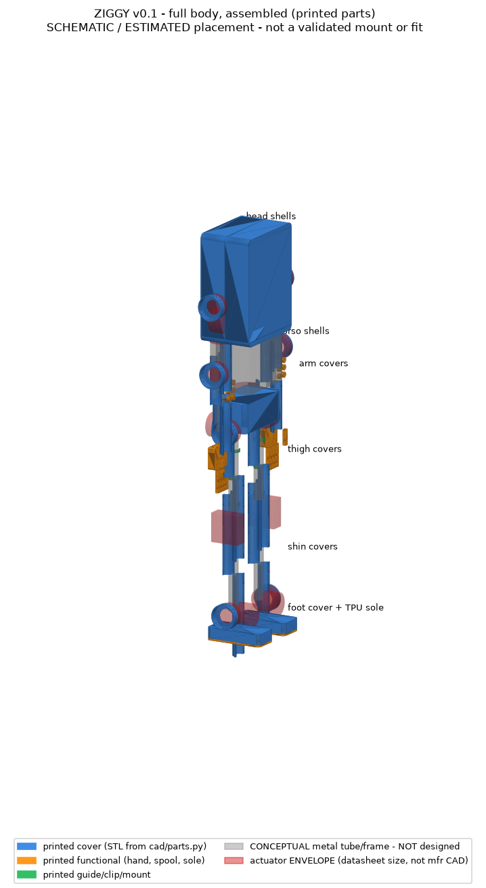
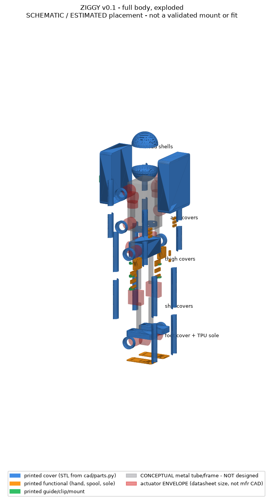
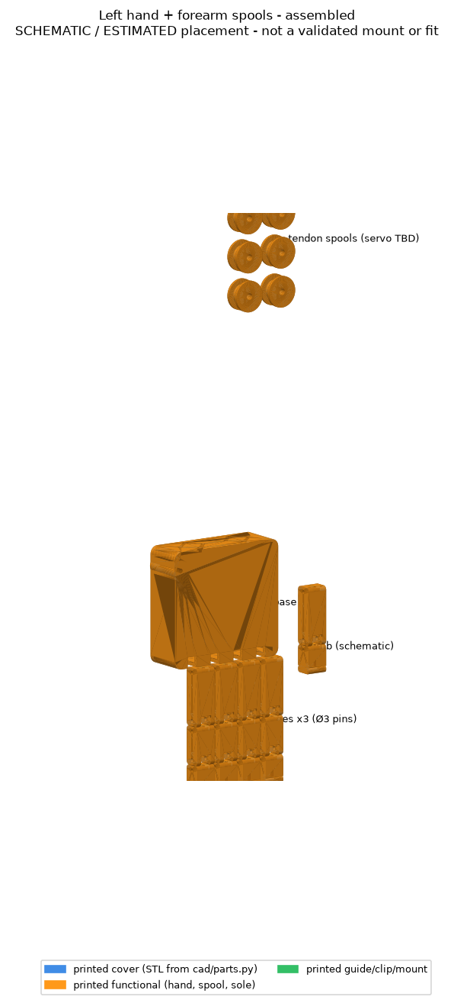
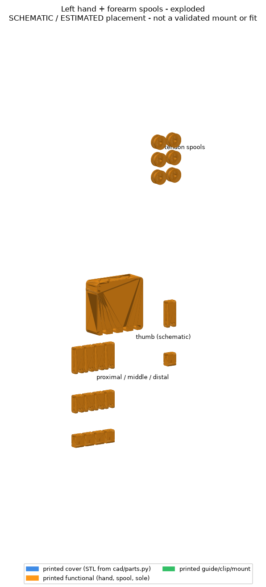

<!-- SPDX-License-Identifier: CC-BY-4.0 -->
# Assembly instructions (concept level, v0.1)

> Several metal parts are **not yet designed**, so this is the intended sequence, not a build manual.

1. **Print and measure the coupons.** Record fits and update `PIN`/`CLR`. Run `python tools/qa.py`.
2. **Bench-test each actuator** on a fixture. Set its CAN ID by bus (CAN0 L-leg … CAN4 torso), set the torque limit to ≤20%, check the encoder direction against `ziggy/params.py` axes, and log the results.
3. **Leg sub-assembly** (per side): hip yaw → hip roll → hip pitch on the pelvis plates, then thigh tube with clamp collars, knee (RS04), shin tube, ankle pitch and roll, then foot plate and `foot_sole_pad`. Route the harness through the cover annulus and fit `cable_clip_tube40` every ~100 mm. Leave service loops. Fit the `thigh_cover_half` and `shin_cover_half` pairs last.
4. **Pelvis and torso**: extrusion frame, battery tray (metal), power distribution board, contactor, safety relay, compute. Mount the E-stop on the back with `estop_mount`.
5. **Arms**: shoulder pitch, roll and yaw, upper arm tube, elbow, forearm (houses hand servos), wrist (TBD).
6. **Hands**: palm_base, then phalanges with dowel pins. Thread the tendons through PTFE liners, wind them on `tendon_spool`s and pre-tension them.
7. **Head**: neck yaw and pitch, then the two `head_shell_half` parts with camera and sensor mount (TBD).
8. **Commissioning**: follow the SAFETY.md ladder: gantry, tether, E-stop function test before every session.

Joint zero calibration: put each limb in its fixture pose, which matches the MJCF zero (straight legs, arms down). Store the encoder offsets.

## Assembled and exploded CAD views
`python tools/cad_views.py` renders these from the **actual exported STLs**, placed with the transforms in `hardware/assembly.json` (86 instances of 18 part types; the two coupons are not placed).

| | |
|---|---|
|  |  |
|  |  |

How to read them:
* **Blue, orange and green** are generated printed CAD.
* **Grey** is the *conceptual* metal tube and frame volume. It is **not designed**.
* **Red** marks actuator **envelopes** from datasheet dimensions (AK80-64 Ø98×62, RS04 120×120×56, AK70-10 Ø89×50). They are not manufacturer CAD.
* Placement is schematic and estimated: there are no mates, no interference check and no fastener model. In particular the actuator covers, thumb and spool positions are illustrative. **The views do not validate fit or mounting.**
